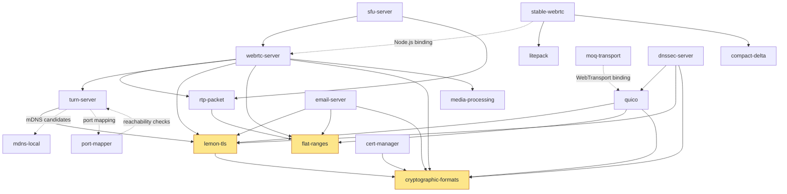

# Aviv Cohen

Author of low-level libraries for Node.js. Pure-JavaScript implementations of core internet protocols - QUIC/HTTP3, TLS, DNSSEC, STUN/TURN, WebRTC, SMTP - alongside supporting libraries for real-time media, data formats, storage, and runtime utilities.

They share a single principle: every layer of the stack should be controllable from code. The protocol becomes a function you write, not a config you maintain.

## Projects

### Networking & internet protocols

| Project | Description |
|---|---|
| ⚡ [**quico**](https://github.com/colocohen/quico) | First full QUIC and HTTP/3 implementation in pure JavaScript for Node.js. |
| 🔐 [**lemon-tls**](https://github.com/colocohen/lemon-tls) | TLS 1.3 / 1.2 implementation with full control over cryptographic keys and the record layer. |
| 📜 [**cert-manager**](https://github.com/colocohen/cert-manager) | ACME and EST client with automatic certificate management. |
| 🌐 [**dnssec-server**](https://github.com/colocohen/dnssec-server) | Handler-based authoritative DNS - answers computed per query in JavaScript, DNSSEC signed at runtime, no zone files. |
| 🔎 [**mdns-local**](https://github.com/colocohen/mdns-local) | Multicast DNS for LAN service discovery and advertising. Bonjour / Avahi compatible. |
| 🛰️ [**turn-server**](https://github.com/colocohen/turn-server) | Embeddable STUN/TURN client and server. Full RFC coverage. |
| 🚪 [**port-mapper**](https://github.com/colocohen/port-mapper) | NAT traversal via UPnP IGD, NAT-PMP, and PCP. Client and server. |
| 📧 [**email-server**](https://github.com/colocohen/email-server) | Full mail stack - SMTP, IMAP, and POP3 (server + client) with DKIM, SPF, DMARC, and MTA-STS built in. |

### Real-time communication & media

| Project | Description |
|---|---|
| 🎥 [**webrtc-server**](https://github.com/colocohen/webrtc-server) | Server-side WebRTC stack with a W3C browser-compatible PeerConnection API. |
| 📺 [**moq-transport**](https://github.com/colocohen/moq-transport) | Media over QUIC Transport (MOQT) for browsers and Node.js. |
| 🔀 [**sfu-server**](https://github.com/colocohen/sfu-server) | Selective Forwarding Unit for multi-party WebRTC. mediasoup v3 API compatibility. |
| 📡 [**stable-webrtc**](https://github.com/colocohen/stable-webrtc) | WebRTC for Node.js and browsers, focused on signaling reliability and connection state in production. |
| 🎙️ [**rtp-packet**](https://github.com/colocohen/rtp-packet) | RTP, RTCP, and SRTP packetization for Node.js. |
| 🎞️ [**media-processing**](https://github.com/colocohen/media-processing) | WebCodecs-compatible API for encoding, decoding, muxing, and demuxing - backed by FFmpeg subprocesses. |

### Data & storage

| Project | Description |
|---|---|
| 💾 [**uni-indexeddb**](https://github.com/colocohen/uni-indexeddb) | Unified key-value storage with the same API across browser (IndexedDB) and server (LevelDB). |
| 🗜️ [**litepack**](https://github.com/colocohen/litepack) | Schema-based binary encoding for JavaScript - compact, fast, zero dependencies. |
| 🗜️ [**compact-delta**](https://github.com/colocohen/compact-delta) | Generic optimal binary delta compression - auto-picks the smallest encoding (copy/insert, Myers LCS, or raw). |

### Cryptography

| Project | Description |
|---|---|
| 🧾 [**cryptographic-formats**](https://github.com/colocohen/cryptographic-formats) | Strict parsing and building of cryptographic formats - X.509, PEM, PKCS#8/#12, CMS, JOSE, COSE, OpenSSH, OpenPGP, ASN.1/DER. Performs no cryptography. |
| 🔑 [**cryptographic-primitives**](https://github.com/colocohen/cryptographic-primitives) | Cryptographic primitives in plain JavaScript - ciphers, hashes, signatures, key exchange. |

### JavaScript primitives & utilities

| Project | Description |
|---|---|
| 🔔 [**deep-events**](https://github.com/colocohen/deep-events) | Path-based event system covering events, state, DOM, workers, and lifecycle cleanup. |
| 📏 [**flat-ranges**](https://github.com/colocohen/flat-ranges) | Merge, subtract, and invert flat numeric ranges. |
| 🔄 [**setrecon**](https://github.com/colocohen/setrecon) | Set reconciliation between two peers over any transport. Picks between IBLT, Strata, buckets, and BCH sketch automatically. |
| 🧮 [**bloom-filter-numbers**](https://github.com/colocohen/bloom-filter-numbers) | Bloom filter optimized for numeric IDs, using splitmix64 and XOR fingerprinting. |
| 🎲 [**pcg64dxsm**](https://github.com/colocohen/pcg64dxsm) | Bit-compatible PCG64-DXSM PRNG. WASM-accelerated, NumPy-compatible. |
| 🌍 [**hint-locale**](https://github.com/colocohen/hint-locale) | Locale detection from browser signals and HTTP headers - country, language, confidence scoring. |
| 🧭 [**js-runtime-environment**](https://github.com/colocohen/js-runtime-environment) | Detect the JavaScript runtime - Browser, Node.js, Deno, Bun, Electron, and more. |

## How they fit together

Most of these libraries are built on each other. Two small foundations sit under everything secure: `cryptographic-formats` parses certificates and keys, and `lemon-tls` provides TLS and DTLS to every protocol that encrypts.

Solid arrows are dependencies a library needs to load. Dashed arrows are optional: `turn-server` and `port-mapper` load each other, `mdns-local` included, only when the feature is used; `stable-webrtc` runs on `webrtc-server` as its Node.js binding; and `moq-transport` ships a binding for `quico`'s WebTransport server. Highlighted libraries are the shared foundation.

## Composing them

The libraries are built to stack. A few combinations that work well together:

**Self-contained edge server** - `quico` + `lemon-tls` + `cert-manager` + `dnssec-server`
Terminates HTTP/3 with keys you control, issues its own certificates, and answers DNS for its own zone. Geo-routing and health-driven failover become `if` statements in the query handler.

**Peer-to-peer media without external infrastructure** - `webrtc-server` + `turn-server` + `port-mapper` + `rtp-packet`
Relays when NAT requires it, opens a direct path when it doesn't, and gives your handler every RTP packet in between.

**LAN-first application** - `mdns-local` + `port-mapper` + `uni-indexeddb`
Discovers peers on the local network, maps its own ports outward when it needs to be reachable, and stores state with one API on both sides of the wire.

## Philosophy

Running nginx, BIND, Postfix, or coturn next to your Node.js application is the standard answer - but it limits you to what their configuration files allow, makes the system hard to extend in directions the original authors didn't anticipate, and puts a process boundary between every layer. Each library here removes that compromise. DNS records are computed at runtime per query, cryptographic keys are held in your own code, every packet is visible to your handler.

The libraries are also intentionally narrow. Each one implements its protocol and stops there. Every decision the protocol doesn't dictate - storage, business logic, signaling transport, architectural choices - stays in your code. They are libraries to compose, not frameworks to inherit.

When that's true, infrastructure stops being something you assemble around your code and becomes part of it. A two-person team can ship a system that used to require a dedicated SRE. Edge deployments don't have to ship without DNS, mail, or media handling. Geo-routing, canary releases, and health-driven failover stop being managed-service features and become a few lines of JavaScript. When something fails at the protocol level, you read source - your source. That's the Node.js these libraries are working toward.

## Contributing

Building production-grade implementations of the entire internet stack in pure JavaScript is more work than one person can finish alone. These projects benefit from anyone willing to read an RFC closely, find the edge case nobody else has hit, or push a library in directions the original draft never imagined. Issues, pull requests, and design discussions are open on every repository - particularly welcome from protocol implementers, security researchers, and engineers running these stacks in production.

## Sponsorship

If your team relies on any of these libraries, sponsorship through [GitHub Sponsors](https://github.com/sponsors/colocohen) supports continued development and maintenance.
